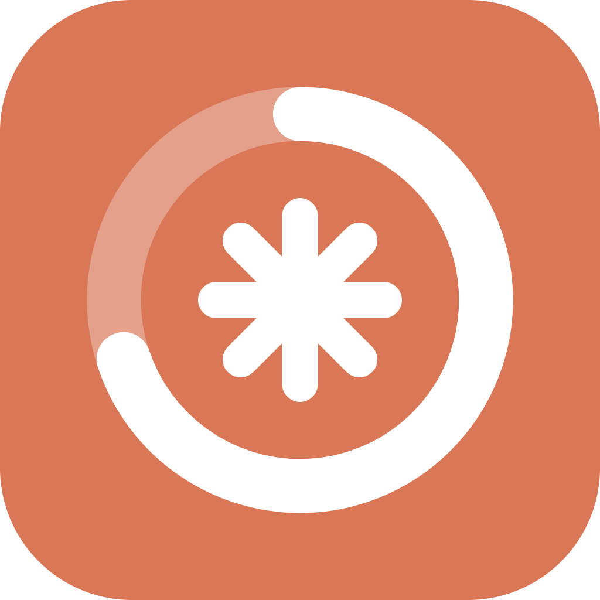

<p align="center">
  
</p>

<h1 align="center">Claude Help</h1>

<p align="center">
  See the usage limits of all your Claude accounts in one window, and get back the sessions that "disappear" when you switch accounts.<br>
  <a href="README.md">中文</a> · <b>English</b>
</p>

---

Claude Help is a Windows desktop app (Electron) with a companion command-line tool, `cchelp`. It's built for people who switch between several Claude accounts in the Claude desktop app:

- See how much of each account's limit is left and when it resets, at a glance.
- Copy an account's address and open its webmail in one click.
- After switching accounts, the desktop app only lists the current account's sessions. Claude Help lists the sessions of every account and lets you pick an old one back up.

> This is not an official Anthropic product and is not affiliated with Anthropic.

The app's interface is in Chinese.

## Features

### Usage

- One card per account, showing how much of the 5-hour and weekly limits is left, a countdown to each reset, and an available / used-up status.
- Sort by weekly remaining, 5-hour remaining, or most recently recorded; filter by email with `Ctrl+F`.
- Records older than a day are flagged as possibly out of date.
- Records can be deleted, with an undo button in the toast.
- Usage is read by Claude inside a desktop-app session and written for the app (see "Recording usage" below). The page refreshes on its own.

### Webmail addresses

- Map an email suffix to a webmail URL, for example `poczta.onet.pl → https://…`.
- The **收信** (Mail) button on a card copies the address, then opens the matching URL in your default browser.
- A suffix matches when the email domain equals it or ends with `.suffix`; when several match, the longest wins.
- If no URL is set up for a suffix yet, the app jumps to the webmail page with the suffix filled in.

### Sessions

The Claude desktop app stores its session list per account, so switching accounts hides the other accounts' sessions. The full conversation transcripts are still on your machine, and the Sessions page brings them back:

- Lists every session on this computer as a tree of **account → project → session**. Projects can be collapsed, and you can filter by title or project name.
- **Copy resume prompt**: start a new session in the current account in the same project folder and paste it. Claude reads the old transcript, sums up where things stand, and carries on.
- **Delete**: moves the session's list file, its transcript, and any subagent transcripts to the Recycle Bin. Nothing is permanently deleted, so you can restore it from there.
- Accounts are shown by ID until you record usage once while signed in to that account; after that they're shown by email.

### Running in the background

Clicking the window's × asks whether to keep Claude Help running in the background (in the system tray, still refreshing when usage is recorded) or quit. Tick "don't ask again" to remember the choice; you can change it later under "关闭窗口时" (When closing the window) on the About page. While it's in the background, click the tray icon to reopen it, or right-click to quit.

### Automatic updates

The app checks this repository's GitHub Releases, downloads new versions in the background, and installs them silently when you restart from the About page.

## Installation

1. Open [Releases](https://github.com/qq876642651-hue/claude-help/releases/latest) and download `Claude-Help-Setup-<version>.exe`.
2. Run the installer; you can choose where to install. The installer isn't code-signed, so Windows may warn about an unknown publisher.
3. The installer adds the install folder to your user PATH. Open a **new** terminal to use `cchelp`. If the Claude desktop app is running, restart it, or its sessions may not find `cchelp`.

Windows only.

## Usage

### Recording usage

Only Claude, inside a desktop-app session, can read usage limits; Claude Help can't read them on its own. To record usage, say this to Claude in the desktop app:

> 用 cchelp 记录额度 (record usage with cchelp)

Claude reads the current account's usage and passes it to `cchelp usage record`, and the app refreshes. The exact steps are in the "给 Claude 的说明" (notes for Claude) section of `cchelp --help`, which Claude follows.

Record once in each account while it's signed in. The first time for an account, Claude asks which email is signed in.

### Command line

| Command | What it does |
|---|---|
| `cchelp` | Show usage for each account, sorted by weekly remaining by default; `--sort weekly\|5h\|recorded`, `--json` |
| `cchelp usage record [--email <email>] [--reassign] [--file <file>]` | Record the current account's usage (plan JSON from stdin or a file); normally run by Claude in a desktop-app session. The session's account is detected automatically, so `--email` is only needed the first time for an account; if `--email` doesn't match the account ID nothing is written, add `--reassign` once confirmed |
| `cchelp usage remove <email>` | Delete one account's usage record |
| `cchelp mail <email> [--print]` | Copy the address and open its webmail URL in the default browser; `--print` only prints the URL |
| `cchelp sites` | List webmail addresses |
| `cchelp sites add <suffix> <url>` / `remove <suffix>` | Add or remove a webmail address |
| `cchelp sessions [--json]` | List every session by account and project |
| `cchelp sessions resume <session ID or prefix>` | Print a resume prompt and copy it to the clipboard |
| `cchelp --help` / `--version` | Help and version |

Deleting sessions is only available in the app, not on the command line, to avoid accidents.

### Keyboard shortcuts

| Shortcut | Action |
|---|---|
| `Ctrl+1` / `Ctrl+2` / `Ctrl+3` / `Ctrl+4` | Go to Usage, Webmail addresses, Sessions, About |
| `Ctrl+F` | Filter by email on the Usage page |

## Data and privacy

Everything stays on your computer; nothing is uploaded.

| Data | Location |
|---|---|
| Usage records | `%USERPROFILE%\.claude\claude-help\usage.json` |
| Webmail addresses | `%USERPROFILE%\.claude\claude-help\mail-sites.json` |
| Session lists (the desktop app's, read-only) | `%LOCALAPPDATA%\Claude-Data\claude_<package ID>\claude-code-sessions\<account ID>\…` |
| Transcripts (Claude Code's, read-only) | `%USERPROFILE%\.claude\projects\<project>\<session>.jsonl` |

The Sessions feature reads **undocumented internal files** of the Claude desktop app. It only reads the title, folder, timestamps, and archived flag, and changes nothing except when you delete a session. A future desktop-app update may change the format; if that happens, the page shows as empty rather than failing.

## Development

You'll need Node.js and npm. All code lives in `app/`; the app and the command line share the modules in `app/src/core/`.

```bash
cd app
npm install
npm start               # run in development
npm run cli -- --help   # run the development command line
npm run icon            # regenerate build/icon.png after editing build/icon.svg
npm run dist            # build the NSIS installer into app/dist/
npm run version:next    # print the next version and the commits grouped by type
npm run release         # release: bump version, commit, push, create the Release, upload, verify
```

When testing, point `USERPROFILE` and `APPDATA` at a temporary folder and pass `--user-data-dir=<temp folder>` to the app. That keeps your real data safe and stops an installed copy of Claude Help from taking the single-instance lock.

### Commits and versions

Commit messages use an English prefix followed by a description (in Chinese in this repo). `app/scripts/release.mjs` works out the version from the commits since the last `v*` tag, so don't edit the version by hand:

| Prefix | Meaning | Version bump |
|---|---|---|
| `break:` | Breaking change | Major |
| `feat:` | New feature | Minor |
| `fix:` | Fix | Patch |
| `chore:`, `docs:`, etc. | Anything else | Patch |

## License

Private project, no license granted (`UNLICENSED`).
